<p align="center"></p>

<h1 align="center">UFC 6 Parsectagon Overlay</h1>

<p align="center">
  Modern multi-layout Vulkan in-frame overlay for <strong>EA SPORTS UFC 6</strong> (PORTHEON / Kyty).<br>
  Replaces <a href="https://github.com/thyaguster/ufc6-actions-overlay">ufc6-actions-overlay</a> with a redesigned UI, 1-click presets, and multiple layout modes built on the same verified engine bridge.
</p>

<p align="center">
  <a href="https://github.com/thyaguster/ufc6-parsectagon-overlay/releases/latest"><strong>Download the latest release</strong></a>
  · <a href="#quick-installation">Quick installation</a>
  · <a href="#ui-types--presets">UI Types &amp; Presets</a>
  · <a href="#overlay-pages">Overlay Pages</a>
  · <a href="#themes">Themes</a>
  · <a href="THIRD_PARTY_NOTICES.md">Credits</a>
</p>

## Quick installation

1. [Download the latest installer](https://github.com/thyaguster/ufc6-parsectagon-overlay/releases/latest) (or build from source below).
2. Close **UFC 6** and **PORTHEON**, run the installer, and select your **`PORTHEON\games\UFC6`** folder (the launcher folder containing `UFC6.exe`, not your extracted game-data folder).
3. Click **Check folder**, then **Install / Update** for the original and Parsec engine (`bin`). If you use **PS5 Pro / DLSS**, click **Switch engine: PS5 Pro**, check its **`novo`** folder, and install there too.
4. Launch UFC 6 normally. Hold **LB + RB + Menu/Start** for ~800 ms, press **Guide**, or press **F10** to open the overlay.

> **Upgrading from `ufc6-actions-overlay`:** `ufc6-parsectagon-overlay` is the direct successor to [ufc6-actions-overlay](https://github.com/thyaguster/ufc6-actions-overlay) and shares the same verified engine hooks, controller-icon patcher, Photo Mode, Replay controls, and Career/Live cheats. Keep `ufc6_pthread_original.dll` intact in `bin\`.

> **Lobby switch for public releases:** Public GitHub/release builds use `-NoLobby` (`UFC6_ENABLE_LOBBY=0`) to keep the Online Lobby tab and in-game Online tab takeover disabled for now.

---

## UI Types & Presets

Switch layouts or 1-click presets live inside the overlay under **Settings → Master preset** or **Appearance & theme → Layout style** (no config editing required):

| Layout / Preset | Preview |
| :--- | :--- |
| **Parsectagon Apex** (Top Bar + Glass) | 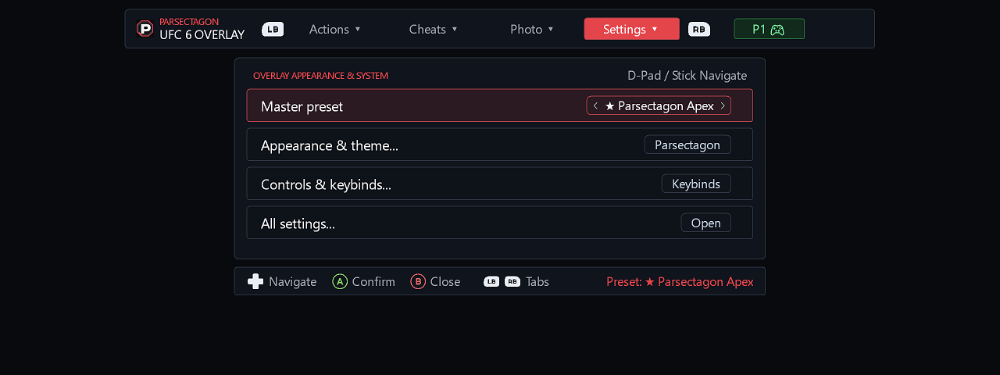 |
| **Octagon Pill** (Floating Island + Pill) | 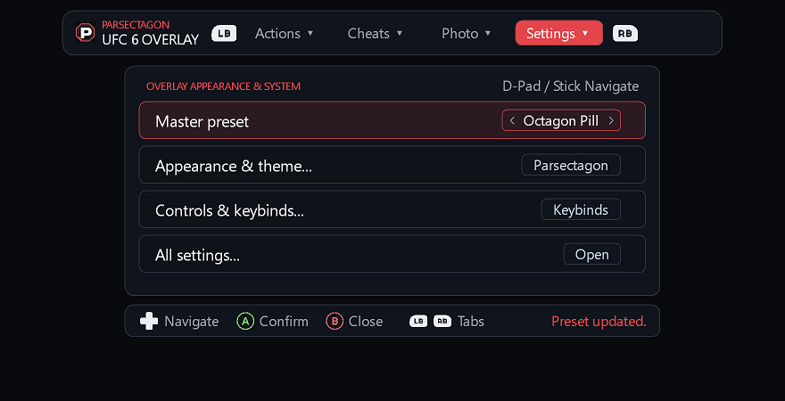 |
| **Championship Solid** (Top Bar + Opaque) |  |
| **Stealth Island** (Floating Island + Glass) | 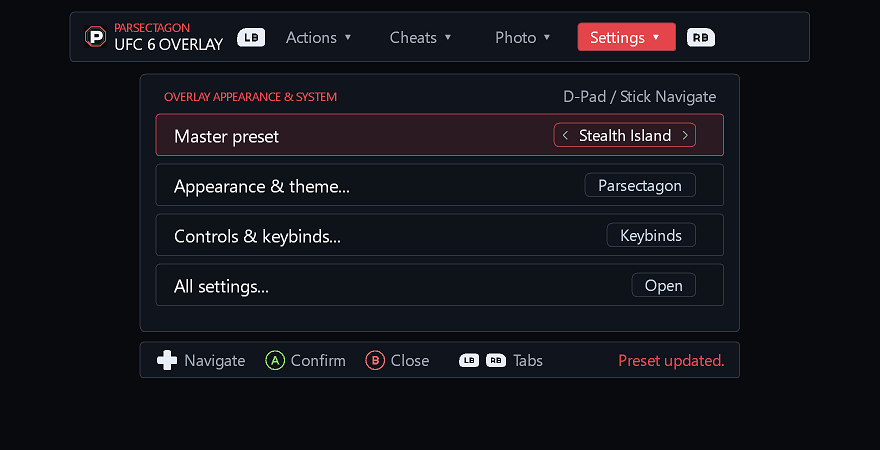 |
| **Side Blade** (Left-Docked Console Rail) | 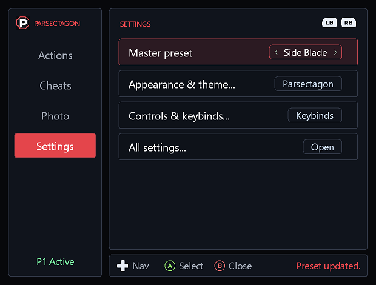 |
| **Bottom Command Dock** (Bottom-Centered Dock) | 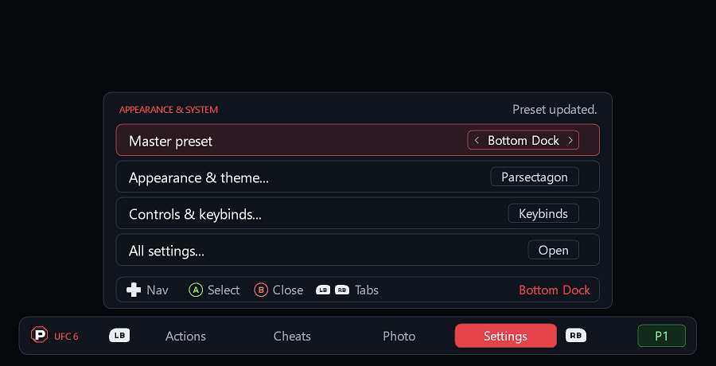 |
| **Bento Split Deck** (2-Column Dashboard) | 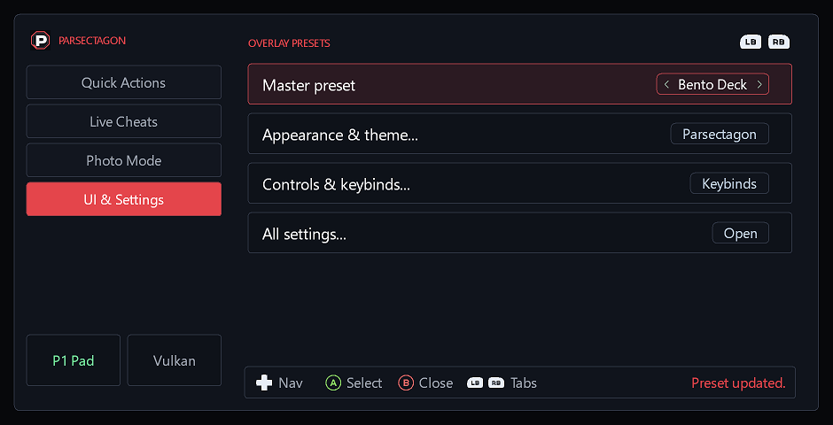 |
| **Broadcast Lower-Third** (Corner PPV Card) | 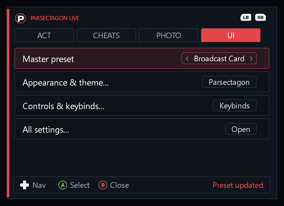 |
| **Octagon Split Hub** (Octagon Badge + Panel) | 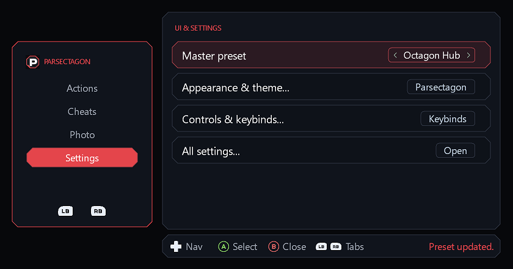 |

---

## Overlay Pages

Use **LB / RB** (or **L1 / R1** on PlayStation) to switch tabs, **D-Pad / Left Stick** to navigate, **A / Cross** to confirm, and **B / Circle** to go back or close.

### Main Tabs
| Actions | Live Cheats |
| :---: | :---: |
| 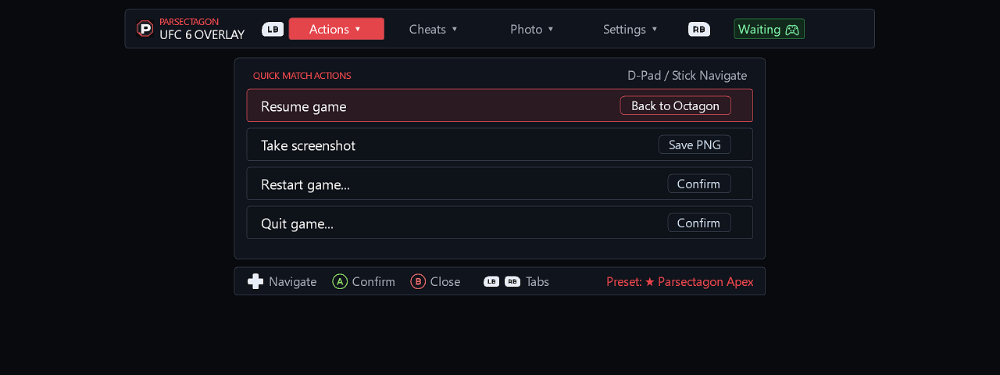 | 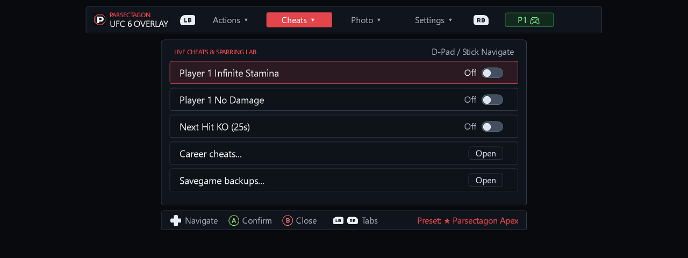 |
| **Photo Mode** | **Settings** |
|  |  |

### Settings & Tool Subpages
| Appearance & Theme | Controls & Keybinds |
| :---: | :---: |
| 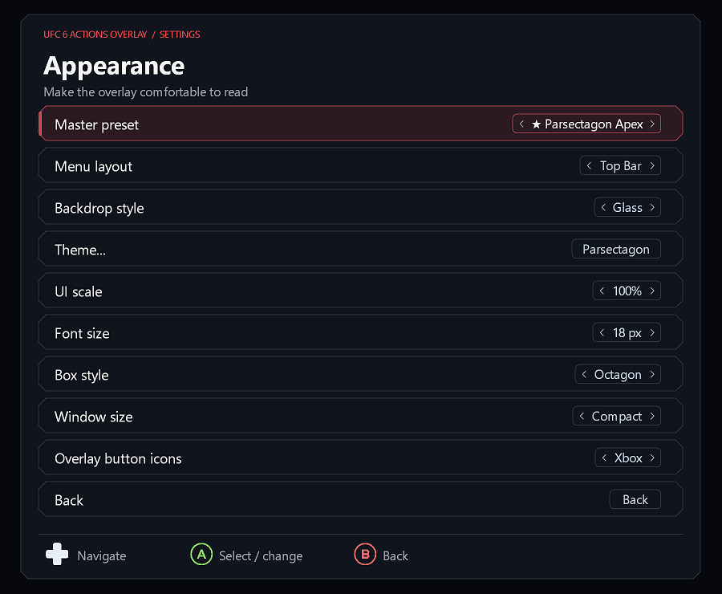 | 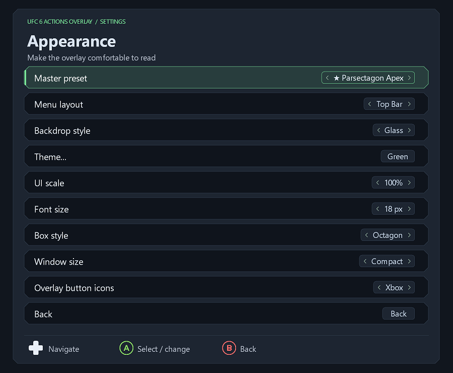 |
| **Game & Launcher** | **Performance Settings** |
| 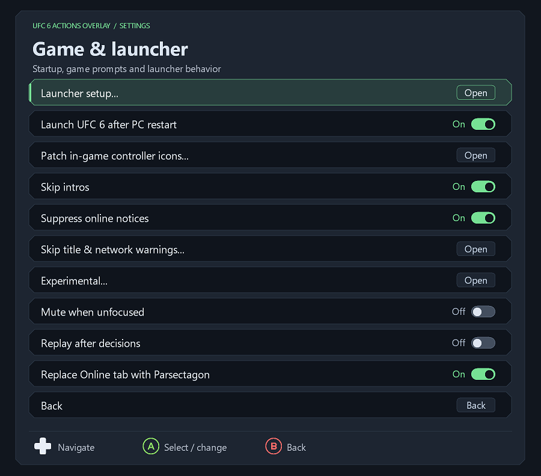 |  |
| **Files & Support** | **Photo Effects & Filters** |
|  | 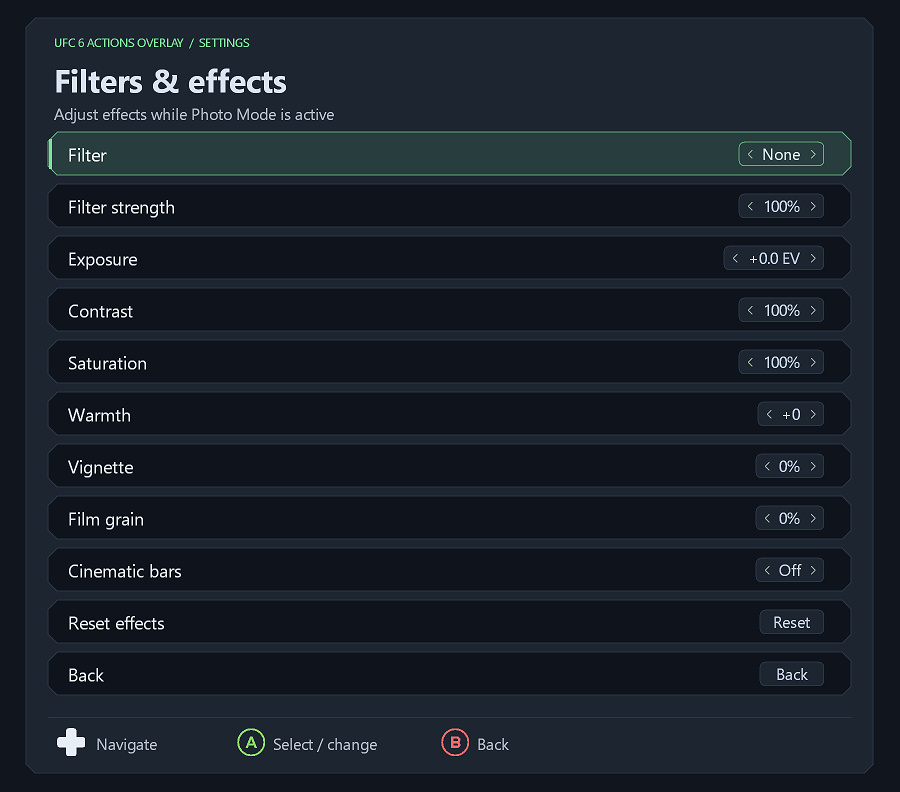 |

---

## Themes

Choose from **Parsectagon**, **Green**, **Blue**, **Red**, **Purple**, **Amber**, or **From config** (`ufc6-overlay-theme.cfg`):

| Parsectagon | Blue | Green |
| :---: | :---: | :---: |
| 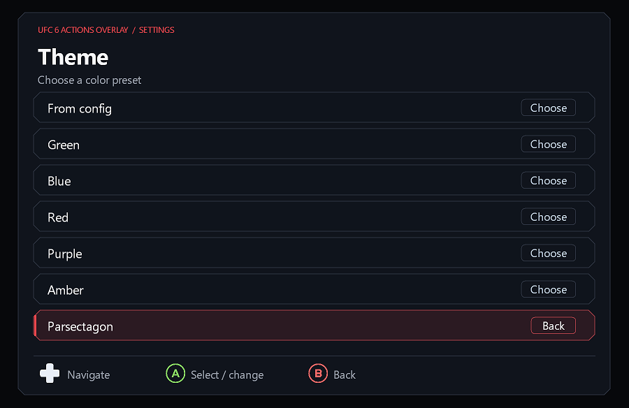 | 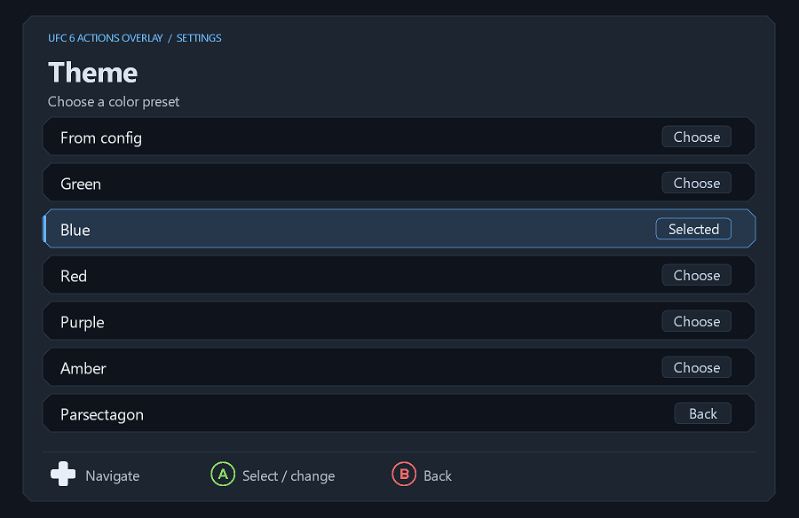 |  |

---

## Building from Source

Requires the local Zig toolchain in `.tools\ziglang\zig.exe` (see `build.ps1`):

```powershell
# Public release build (Lobby disabled)
pwsh -NoProfile -ExecutionPolicy Bypass -File .\build.ps1 -NoLobby

# Run test suite (Lobby disabled)
pwsh -NoProfile -ExecutionPolicy Bypass -File .\build.ps1 -Test -NoLobby

# Package release ZIP + setup EXE (Lobby disabled)
pwsh -NoProfile -ExecutionPolicy Bypass -File .\package.ps1 -NoLobby
```

Omit `-NoLobby` to build with the Parsectagon Lobby tab enabled.

## Documentation & Notices

- [Replay & Photo Mode guide](docs/PHOTO-MODE.md)
- [Performance settings](docs/PERFORMANCE.md)
- [Startup options](docs/STARTUP.md)
- [Release history](RELEASE-NOTES.md)
- [License](LICENSE) · [Third-party notices](THIRD_PARTY_NOTICES.md)
