<p align="center"></p>

<h1 align="center">UFC 6 Parsectagon Overlay</h1>

<p align="center">
  Modern multi-layout Vulkan in-frame overlay for <strong>EA SPORTS UFC 6</strong> &amp; <strong>EA SPORTS UFC 4</strong> (PORTHEON / Kyty).<br>
  Replaces <a href="https://github.com/thyaguster/ufc6-actions-overlay">ufc6-actions-overlay</a> with a redesigned UI, 1-click presets, Parsectagon Lobby integration, and multiple layout modes.
</p>

<p align="center">
  <a href="https://github.com/thyaguster/ufc6-parsectagon-overlay/releases/latest"><strong>Download the latest release</strong></a>
  · <a href="https://parsectagon.cc"><strong>Parsectagon</strong></a>
  · <a href="https://discord.gg/a84pBw2Ff"><strong>Discord</strong></a>
  · <a href="#quick-installation">Quick installation</a>
  · <a href="#ui-types--presets">UI Types &amp; Presets</a>
  · <a href="#overlay-pages">Overlay Pages</a>
  · <a href="#themes">Themes</a>
  · <a href="THIRD_PARTY_NOTICES.md">Credits</a>
</p>

## Quick installation

1. [Download the latest installer](https://github.com/thyaguster/ufc6-parsectagon-overlay/releases/latest): **UFC6-Parsectagon-Overlay-Setup-*.exe**.
2. Close **UFC 6**, **UFC 4**, and **PORTHEON**, run the installer, and select your **`PORTHEON\games`** folder (to auto-detect both games) or an individual **`PORTHEON\games\UFC6`** / **`PORTHEON\games\UFC4`** folder.
3. Check **UFC 6** and/or **UFC 4** in the installer, click **Check**, then **Install / Update** once. For UFC 6, the installer handles both **Original / Parsec (`bin`)** and **PS5 Pro / DLSS (`novo`)** when present; for UFC 4, it installs the shared overlay, controller prompt patcher, fight-report watcher, DLC & vanity unlocker, and Online menu Parsectagon takeover (see [UFC 4 details](ufc4/README.md)).
4. Launch UFC 6 or UFC 4 normally. Hold **LB + RB + Menu/Start** for ~800 ms, press **Guide**, or press **F10** to open the overlay.

> **After a PORTHEON update:** If a PORTHEON update overwrites overlay files, run the installer and click **Repair / Reinstall** to restore the selected games while keeping your settings, screenshots, and backups (`ufc6_pthread_original.dll` / `ufc4-overlay-backup`).

**Support report:** Open **Export support report...** in setup or from the overlay. One ZIP contains separate component checks and bounded logs for both `bin` and `novo` when present. New reports are saved in `Documents/UFC 6 Parsectagon Overlay/SupportReports`; older reports remain in the previous folder.

> **Upgrading from `ufc6-actions-overlay`:** `ufc6-parsectagon-overlay` is the direct successor to [ufc6-actions-overlay](https://github.com/thyaguster/ufc6-actions-overlay) and shares the same verified engine hooks, controller-icon patcher, Photo Mode, Replay controls, and Career/Live cheats. Keep `ufc6_pthread_original.dll` intact in `bin\`.

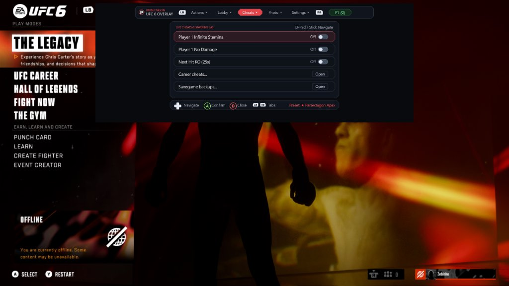

---

## UI Types & Presets (In-Game)

Switch layouts or 1-click presets live inside the overlay under **Settings → Master preset** or **Appearance & theme → Layout style** (no config editing required):

| Layout / Preset | In-Game View |
| :--- | :--- |
| **Parsectagon Apex** (Top Bar + Glass) |  |
| **Octagon Pill** (Floating Island + Pill) | 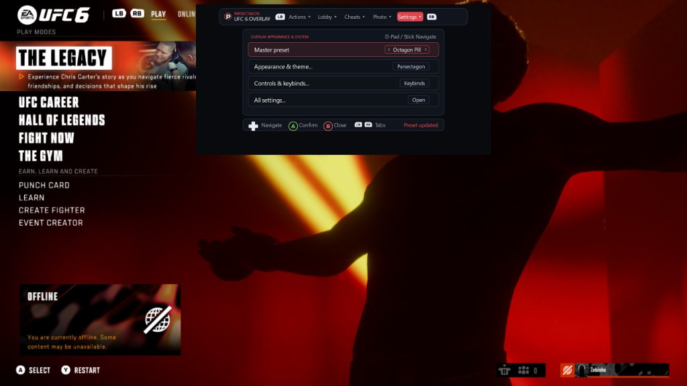 |
| **Side Blade** (Left-Docked Console Rail) | 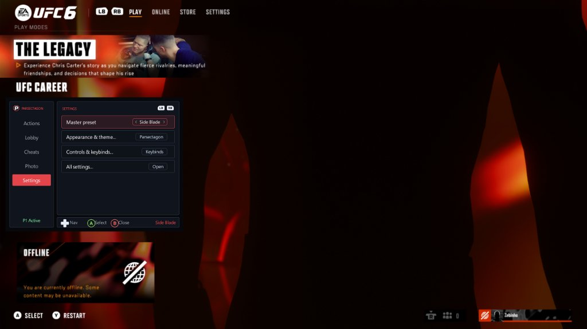 |
| **Bottom Command Dock** (Bottom-Centered Dock) | 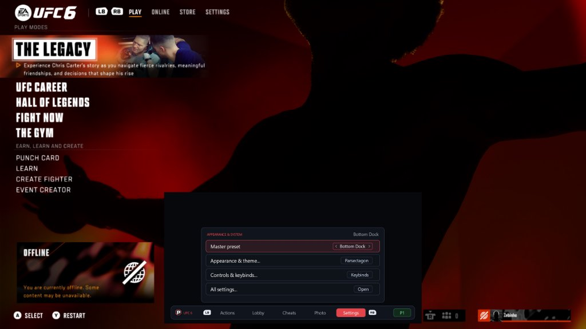 |
| **Bento Split Deck** (2-Column Dashboard) | 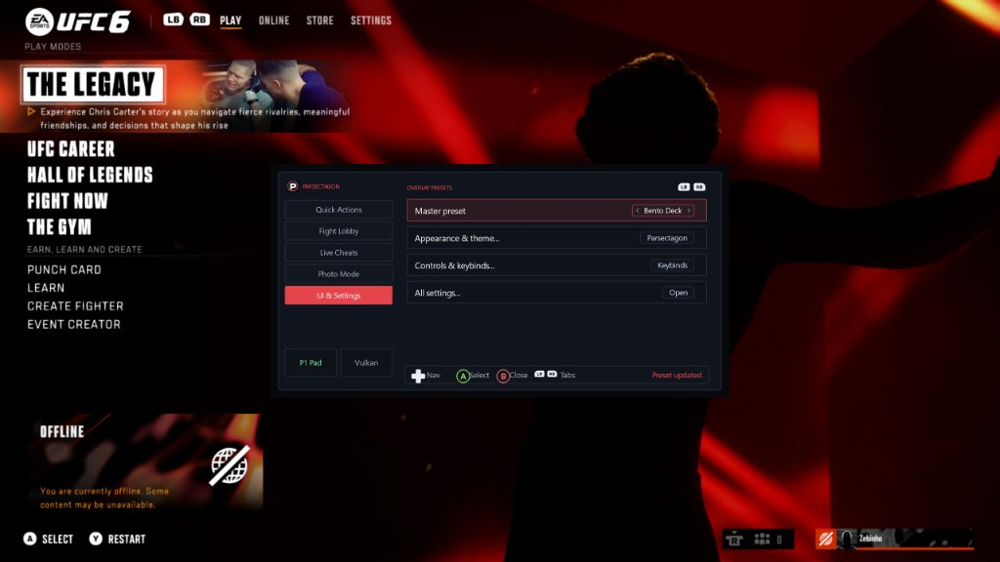 |
| **Broadcast Lower-Third** (Corner PPV Card) | 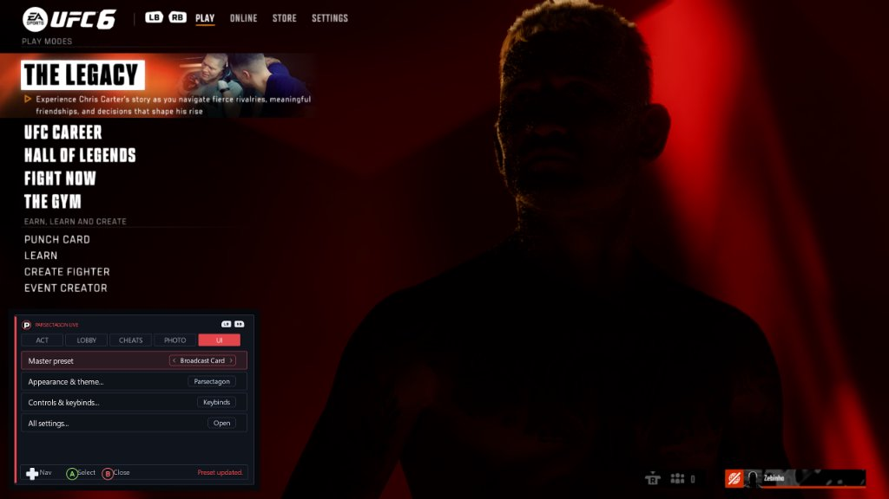 |
| **Octagon Split Hub** (Octagon Badge + Panel) | 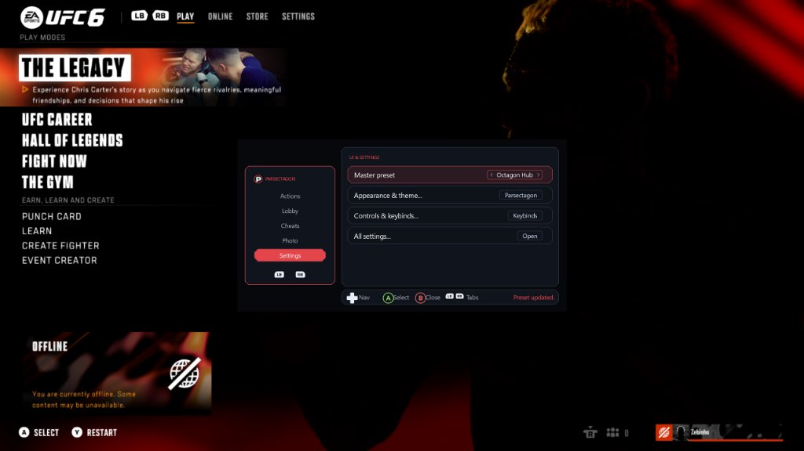 |
| **Championship Solid** (Top Bar + Opaque) | 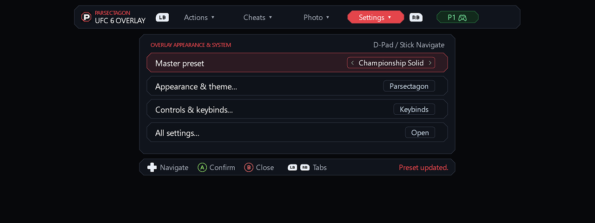 |
| **Stealth Island** (Floating Island + Glass) |  |

---

## Overlay Pages

Use **LB / RB** (or **L1 / R1** on PlayStation) to switch tabs, **D-Pad / Left Stick** to navigate, **A / Cross** to confirm, and **B / Circle** to go back or close.

### Main Tabs
| Actions | Live Cheats |
| :---: | :---: |
|  |  |
| **Photo Mode** | **Settings** |
| 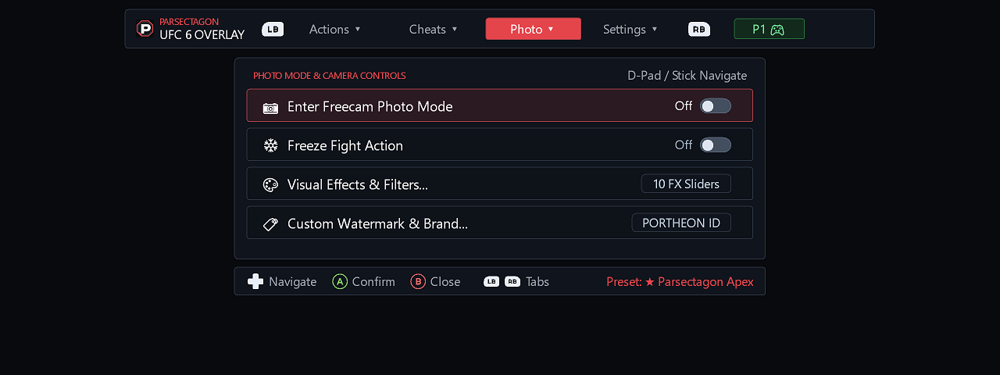 |  |

### Settings & Tool Subpages
| Appearance & Theme | Controls & Keybinds |
| :---: | :---: |
|  |  |
| **Game & Launcher** | **Performance Settings** |
|  | 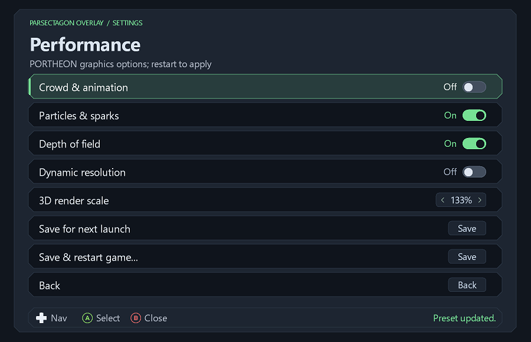 |
| **Files & Support** | **Photo Effects & Filters** |
| 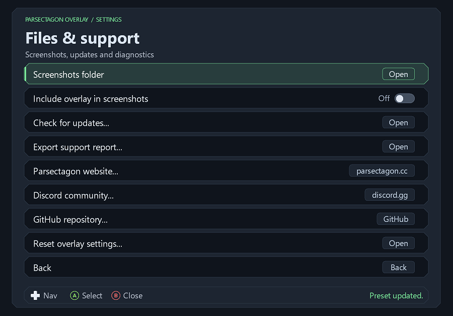 |  |
| **FPV / POV Camera (Beta)** | **Setup & Clean Kyty Installer** |
| 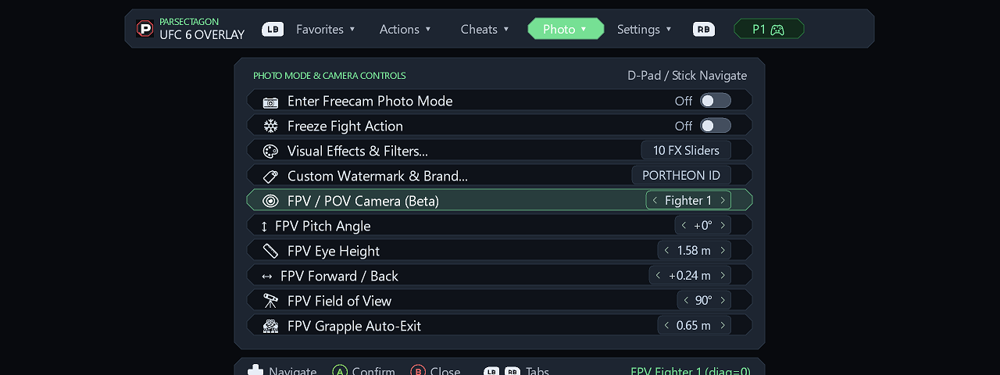 | 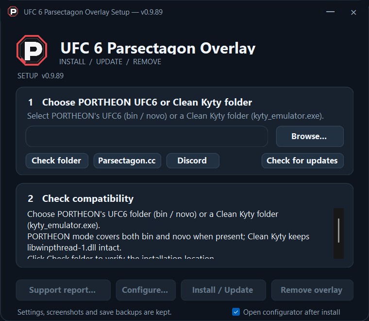 |

---

## Themes

Choose from **Parsectagon**, **Green**, **Blue**, **Red**, **Purple**, **Amber**, or **From config** (`ufc6-overlay-theme.cfg`):

| Parsectagon | Blue | Green |
| :---: | :---: | :---: |
|  |  | 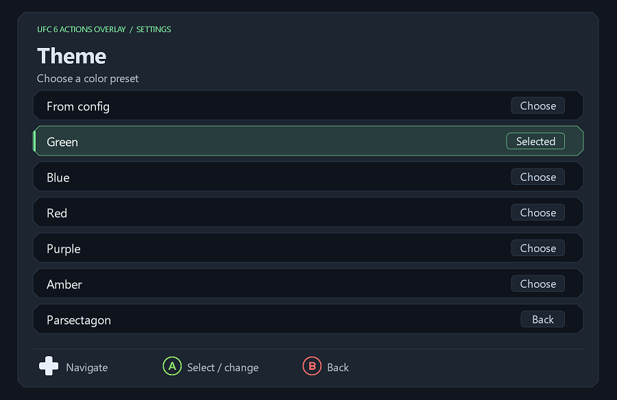 |

---

## Building from Source

Requires the local Zig toolchain in `.tools\ziglang\zig.exe` (see `build.ps1`):

```powershell
# Full build (UFC 6 + UFC 4, Parsectagon Lobby enabled)
pwsh -NoProfile -ExecutionPolicy Bypass -File .\build.ps1

# Run test suite
pwsh -NoProfile -ExecutionPolicy Bypass -File .\build.ps1 -Test

# Package release ZIP + setup EXE
pwsh -NoProfile -ExecutionPolicy Bypass -File .\package.ps1
```

Pass `-NoLobby` to disable the Parsectagon Lobby tab if needed.

## Documentation & Notices

- [Replay & Photo Mode guide](docs/PHOTO-MODE.md)
- [Performance settings](docs/PERFORMANCE.md)
- [Startup options](docs/STARTUP.md)
- [Release history](RELEASE-NOTES.md)
- [License](LICENSE) · [Third-party notices](THIRD_PARTY_NOTICES.md)
