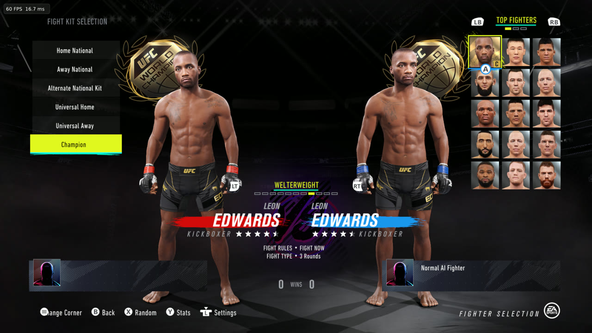
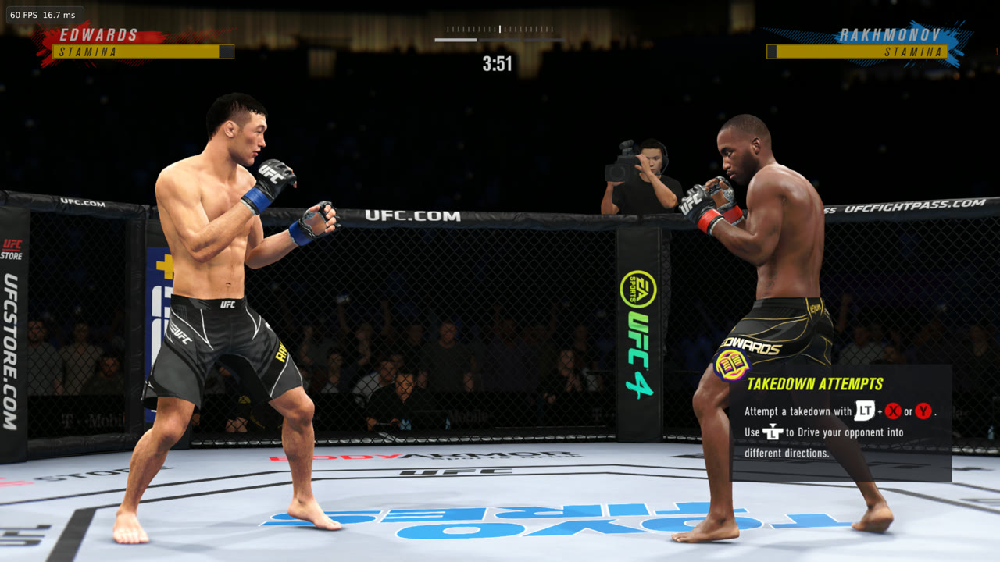
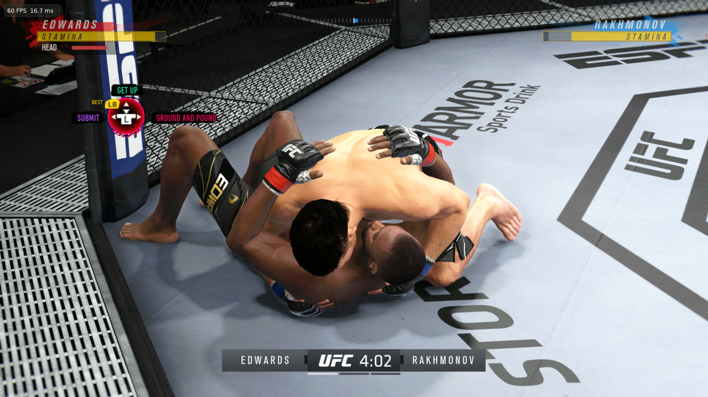
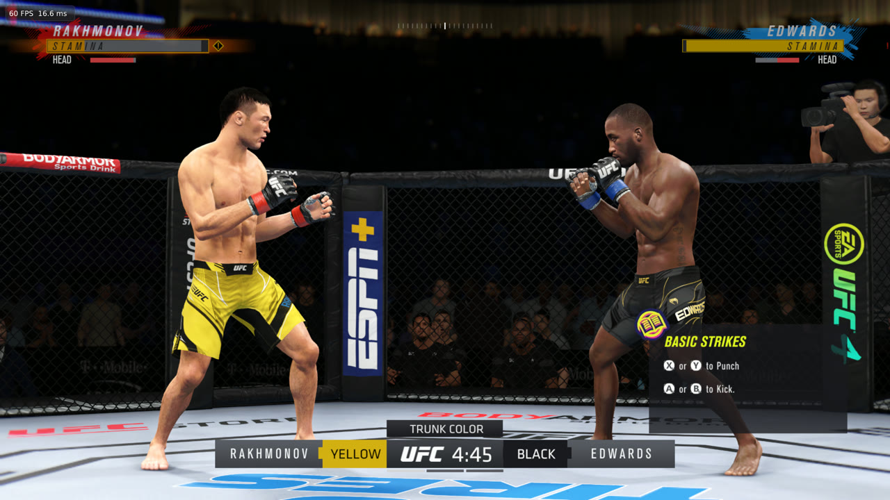

# UFC 4 Xbox icon checkpoint

Status: **menus accepted; inline tutorial icons still need work**. The game renders these prompts from small, separate GNF textures. The player confirmed on 2026-11-23 that LT, stick and A/B icons in a takedowns tutorial still look poor after the trigger/bumper edge correction.

## What was changed

UFC 4 uses two separate prompt systems, so the Xbox option has two parts:

1. `src/ufc4_icon_art.py` switches the Flash/button-art symbols used by menus. UFC 4 already contains authored PlayStation and Xbox artwork; this patch changes the symbol mapping and keeps the operation reversible.
2. `src/ufc4_direct_icons.py` handles the separate GNF textures used by fight HUD and tutorial prompts. `src/ufc4_stock_xbox.py` extracts UFC 4's own authored Xbox glyphs from the validated button-art source and fits them into those textures.

The first direct-icon attempt used artwork that looked acceptable in menus but was oversized and rough in tutorial text. The current renderer:

- reuses UFC 4's stock Xbox glyphs instead of redrawing them;
- renders them at `0.72` of the available slot, leaving transparent breathing room because tutorial text draws the entire texture slot;
- uses Lanczos resizing;
- deliberately keeps the original PlayStation-style left/right ground-stick indicators (`text_ground_game_hud/las.gnf` and `ras.gnf`), because the attempted Xbox replacement was less readable.
- preserves the native wide footer Options-button container but replaces its visible artwork with a right-aligned Xbox Menu glyph, so UFC 4 reserves the correct space before `Menu` and `Close Menu`.
- preserves the native Select-button footer container with a right-aligned Xbox View glyph, so it has room before `Player Hub`. This followed a screenshot showing the old icon overlapping that label. The generated glyph and archive migration pass the offline icon tests; in-game visual confirmation is pending.

The first View-glyph revision used a hard two-color mask and looked poor in the player's screenshot. It was replaced with a smaller, graded rendering of the game's stock Xbox View artwork on 2026-11-22. The installed archive matches the new generated art; the updated appearance awaits an in-game screenshot.

The in-fight `A Skip` prompt exposed a separate GNF issue: BC7 compression left bright flecks outside the face-button circles. For the four Xbox face-button textures, fully transparent pixels now carry the circle's white RGB while keeping alpha zero. A decoded before/after preview showed the stray pixels removed. All five `digital_one` variants in the local game archive match the regenerated Xbox textures; the in-game result awaits a new screenshot.

Generated PlayStation, Xbox and keyboard payloads remain reversible. Before a write, the patcher validates that every target still matches one of its prepared variants; a failed write is rolled back.

## What was visually tested

- Fighter selection and post-fight/pause navigation prompts: Xbox artwork was clear and correctly mapped.
- Standing tutorial cards: face buttons and triggers were exercised; oversized/rough rendering was identified and the direct textures were changed to use padded stock artwork.
- Ground prompts: the replacement L/R stick art was tested and rejected; Xbox mode now preserves the original ground-stick indicators.
- Basic strikes, takedowns, ground transitions and joint-submission tutorial contexts were inspected during the November 18 test session.
- The current result was judged good enough to continue, but this was not an exhaustive pass over every tutorial card in every mode.

When locally prepared v28 artwork is available, the automated tests cover exact switch/restore behavior, archive validation, variant sizing, Xbox-vs-PlayStation texture changes, the intentional ground-stick exception, and the four-key keyboard ground indicator.

## Test-history captures

These are development evidence, not four screenshots of the final build. Their labels explain what each one established.

### Menu baseline — already good



### Original tutorial problem — colored icons filled the slots



### Rejected ground-stick replacement



The current Xbox variant intentionally leaves this ground indicator as the original PlayStation-style graphic.

### Stock-art tutorial baseline



This capture established that UFC 4's authored white glyphs were the better source. The renderer was then given additional transparent padding for full-slot tutorial rendering.

### Inline trigger and bumper edge correction (2026-11-23)

The stock LT/LB/RT/RB bitmaps have torn outer silhouettes, visible in loading tips and in-fight tutorial text after they are reduced to the small GNF slots. The four `white/` single trigger and bumper textures now retain the stock lettering while using a clean outer mask. They use BC7 mode 5 so color and transparency have independent indices. The Xbox menu icons, A/B/X/Y tutorial icons, and the confirmed `A Skip` icon keep their prior rendering and encoding. Decoded previews looked cleaner, but the player's in-game takedowns screenshot confirmed that the inline set still looks poor. A/B/X/Y remain on the visual review list: a circular-mask experiment looked more pixelated at their small native size and was not installed. The original PlayStation GNF textures are also visibly rough when decoded at their 28–40 pixel native sizes, so another same-size source bitmap or contour adjustment is unlikely to resolve the set. Revisit only with a way to render the prompts at higher effective resolution or change the game-side rendering path.

## Source and generated assets

Source-controlled implementation:

- `src/ufc4_icon_art.py` — reversible Flash/menu mapping
- `src/ufc4_buttonart_xbox_tail.bin` — compact validated mapping payload
- `src/ufc4_direct_icons.py` — direct GNF inventory, variants and switching
- `src/ufc4_stock_xbox.py` — extraction and padded rendering of UFC 4's stock Xbox glyphs
- `tests/test_ufc4_icon_art.py`
- `tests/test_ufc4_direct_icons.py`

The prepared files (`ufc4_buttonart_*.bin`, `ufc4_direct_icons_*.bin`, and `ufc4_direct_icons_map.json`) are generated locally from the user's validated UFC 4 archive. They are build/install artifacts, not portable source assets, and should not be committed as game data.

## How to report the next odd icon

Take a full-frame screenshot with **F12** or **F10 → Take screenshot**. UFC 4 saves it under Windows `Pictures/Screenshots` with a `UFC4_` prefix. Keep the full screen so the prompt's rendering context is visible.

When sending it, include:

- selected prompt style (Xbox);
- screen or tutorial title;
- which glyph is wrong;
- whether the problem is size, rough edges, wrong mapping, stretching, clipping or alignment;
- if practical, a second screenshot of the same prompt using PlayStation artwork for comparison.

Each confirmed case can be added to `docs/xbox-icons/` with a short entry here. That gives us a concrete visual checklist without reopening prompts that are already acceptable.

## Validation

From the repository root:

```powershell
python -m unittest ufc4.tests.test_ufc4_icon_art ufc4.tests.test_ufc4_direct_icons
```

The binding test runs without game assets. Artwork tests use locally prepared v28 artifacts and skip when those artifacts are absent; the local install step validates the supported archive before generating or applying them.
